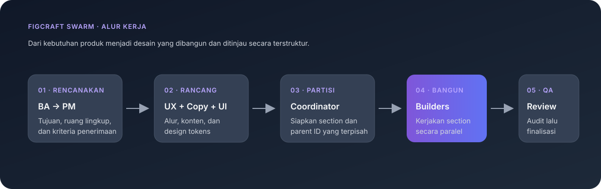

# FigCraft Swarm Plugin

Plugin lokal untuk menghubungkan **Antigravity** dengan aplikasi desktop **FigCraft** melalui MCP Server dalam mode *Live Canvas*. Plugin ini menyediakan tim multi-agent yang membantu mengubah kebutuhan produk menjadi desain UI secara terstruktur—mulai dari perencanaan hingga pemeriksaan kualitas.

> **Status screenshot:** repository ini belum menyertakan screenshot aplikasi FigCraft. Diagram di bawah menjelaskan alur kerja plugin, bukan screenshot antarmuka. Setelah Anda mengambil screenshot dari aplikasi, simpan gambarnya di `docs/images/` dan tambahkan dengan sintaks Markdown yang tersedia di bagian [Screenshot](#screenshot).

## Gambaran alur kerja



Alur ini menggunakan pendekatan *partitioned multi-writer*: setiap builder bekerja pada section atau parent yang ditetapkan, sementara coordinator mengatur eksekusi dan mencegah perubahan saling bertabrakan.

## Fitur utama

- **Live Canvas MCP** — menghubungkan plugin ke instance FigCraft yang sedang berjalan.
- **Kolaborasi multi-agent** — spesialis menangani analisis bisnis, perencanaan produk, UX, UI, dan penulisan konten.
- **Pembangunan section secara paralel** — builder bekerja pada partisi kanvas yang telah disiapkan coordinator.
- **Pemeriksaan desain** — QA meninjau struktur layer dan screenshot kanvas terhadap spesifikasi.

## Komponen

| Komponen | Tugas |
| --- | --- |
| `figcraft-live` | MCP Server yang menjalankan `figcraft-cli mcp --attach 7979` untuk terhubung ke aplikasi FigCraft. |
| `figcraft-swarm-build` | Panduan orkestrasi dari discovery sampai QA dengan Hybrid Pola B. |
| `figcraft-ba` | Merangkum tujuan bisnis, aktor, aturan, dan alur proses/data. |
| `figcraft-pm` | Menyusun *Product Brief*, ruang lingkup, dan kriteria penerimaan. |
| `figcraft-ux-designer` | Merancang arsitektur informasi, *user flow*, dan hierarki layout. |
| `figcraft-ui-designer` | Menetapkan design tokens serta spesifikasi visual per section. |
| `figcraft-copywriter` | Menulis teks UI final, seperti headline, CTA, label, dan microcopy. |
| `figcraft-builder` | Membangun section sesuai partisi yang ditetapkan coordinator. |
| `figcraft-qa` | Meninjau layer dan screenshot secara *read-only*, lalu melaporkan temuan. |
| `rules/AGENTS.md` | Aturan kerja untuk mengurangi konflik saat mengubah Live Canvas. |

## Prasyarat

Sebelum menggunakan plugin, pastikan:

1. **FigCraft** dan **`figcraft-cli`** sudah terpasang dan dapat dijalankan dari `PATH`.
2. Aplikasi desktop FigCraft berjalan dengan control port `7979`.
3. Antigravity dapat membaca konfigurasi MCP plugin ini.

Jalankan FigCraft dengan control port aktif:

```powershell
figcraft --control 7979
```

Konfigurasi MCP (`mcp_config.json`) akan menjalankan server dengan perintah berikut saat plugin dimuat:

```bash
figcraft-cli mcp --attach 7979
```

## Instalasi

Salin folder plugin ini ke direktori plugin lokal Antigravity:

```text
~/.gemini/config/plugins/figcraft/
```

Pastikan file `plugin.json`, `mcp_config.json`, serta folder `agents/`, `rules/`, dan `skills/` berada langsung di dalam folder `figcraft/`. Jika Antigravity tidak mendeteksi plugin, periksa kembali lokasi folder dan mulai ulang atau muat ulang konfigurasi Antigravity.

## Cara menggunakan

1. Jalankan aplikasi FigCraft dengan control port `7979`.
2. Pastikan MCP `figcraft-live` terhubung ke aplikasi.
3. Minta Antigravity menjalankan skill `figcraft-swarm-build` untuk membuat desain.
4. Berikan tujuan, konteks produk, pengguna sasaran, dan kebutuhan desain yang Anda inginkan.
5. Coordinator memeriksa kanvas, menyiapkan partisi section, lalu mengatur builder.
6. Setelah pembangunan selesai, jalankan pemeriksaan QA dan tinjau hasilnya di kanvas FigCraft.

> Sebelum eksekusi, skill akan memeriksa dokumen aktif. Builder seharusnya hanya mengubah parent/section yang ditugaskan kepadanya.

## Screenshot

Belum ada screenshot antarmuka FigCraft yang tersedia di repository ini. Untuk menambahkannya, ambil screenshot kanvas setelah desain selesai, lalu simpan misalnya sebagai:

```text
docs/images/figcraft-canvas.png
```

Kemudian ganti catatan ini dengan gambar berikut:

```markdown

```

Untuk screenshot tambahan, simpan file lain di `docs/images/` dan beri keterangan singkat agar pembaca mengetahui bagian yang ditampilkan.

## Struktur direktori

```text
figcraft-swarm-plugin/
├── agents/                   # Peran dan instruksi tiap agent
├── docs/
│   └── images/               # Diagram dan screenshot dokumentasi
├── rules/
│   └── AGENTS.md             # Aturan kerja pada Live Canvas
├── skills/
│   └── figcraft-swarm-build/
│       └── SKILL.md          # Alur orkestrasi pembangunan desain
├── mcp_config.json           # Konfigurasi MCP Server
├── plugin.json               # Metadata plugin
└── README.md
```

## Bantuan dan troubleshooting

- **Plugin atau MCP tidak terdeteksi:** pastikan folder plugin berada di lokasi instalasi yang benar dan konfigurasi JSON valid.
- **Tidak dapat terhubung ke FigCraft:** pastikan aplikasi berjalan dengan `--control 7979`, lalu pastikan `figcraft-cli` tersedia di `PATH`.
- **Periksa panduan detail:** lihat `skills/figcraft-swarm-build/SKILL.md` untuk langkah orkestrasi, pembagian section, dan proses QA.

## Lisensi

Lihat file [`LICENSE`](LICENSE).
